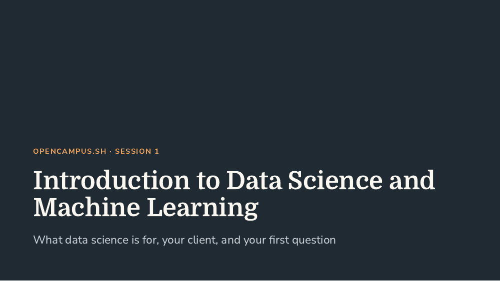

# Week 1 – Introduction to Data Science

**Question of the week (from the operations manager):** _Should the bakery start selling its seasonal bread (product group 6) in October or only in November?_

**Skills:** you install the course skills this week; you start using them in [week 2](week-02-import-and-visualization.md).

### This week you will ...

* distinguish data science, machine learning, AI and AI agents, and relate them to everyday examples,
* get to know the course structure, the flipped classroom format and our client, the bakery’s operations manager,
* get to know the team project and its question, _how much of each product group should we bake for tomorrow?_, which your team takes on from week 3,
* use a coding agent to answer the question of the week with data: import it, compute descriptive statistics and run a first significance test.

**Slides:**

<figure><figcaption><p><a href="../../.gitbook/assets/intro-ds-week-01-slides.pdf">Open the session 1 slides (PDF)</a></p></figcaption></figure>

### Until next session you should ...

#### 1. Get your practice repository

* [x] **Clone the practice repository.** In VS Code, click _Clone Git Repository…_ (as in the [Preparation](preparation.md)) and paste:

  
  ```
  https://github.com/opencampus-sh/repo-template-intro-to-data-science-and-ml
  ```
  

  Choose a folder **next to** your course resources folder (the `intro-to-data-science-and-ml` folder from the Preparation), not inside it.
* [x] **Open the new folder** in VS Code (_File → Open Folder…_) and open your agent’s panel there (for example the Claude Code or Codex icon in the side bar).

<details>

<summary>Why a separate practice repository?</summary>

The practice repository is a copy of the [template repository](https://github.com/opencampus-sh/repo-template-intro-to-data-science-and-ml) that stays on your laptop. You use it to try things out in weeks 1 and 2. You do not need your own GitHub repository or any commits until your team starts in week 3.

</details>

#### 2. Install the course skills

Skills are ready-made instructions that guide your agent through the steps of a data science project. You install them once.



1. When Claude Code asks whether you trust this folder, answer **Yes**. Make sure VS Code is not in _Restricted Mode_ (you see it in the bottom left corner).
2. Type these two commands into the Claude Code chat, one after the other, and press Enter after each:

   
   ```
   /plugin marketplace add steffen74/agentic-data-science
   ```
   

   
   ```
   /plugin install agentic-data-science@agentic-data-science
   ```
   
3. Close Claude Code and open it again.
4. **Test:** type `/setup`. You are done when `setup-ds-project` appears in the menu (it may be shown as `agentic-data-science:setup-ds-project`).

These commands are typed into the chat, not into a terminal, so they are the same on Windows, macOS and Linux.



1. Install [Node.js](https://nodejs.org/) (version 22.20 or newer; the LTS version is fine) and restart VS Code.
2. Paste this prompt into your agent’s chat:

   
   ```
   Run this command in the current folder (on Windows, use npx.cmd instead of npx):
   npx skills@latest add steffen74/agentic-data-science --skill '*' --agent codex -y
   ```
   

   If you use Copilot or Cursor, replace `--agent codex` with `--agent '*'`.
3. The agent asks for permission to run the command: approve it.
4. **Test:** in Codex, type `/skills`. You are done when `setup-ds-project` is in the list. In Codex, you start a skill with `$` instead of `/` (for example `$setup-ds-project`).



<details>

<summary>The skills do not appear</summary>

* Close VS Code completely and open the practice folder again.
* Check that you opened the practice folder itself, not the folder above it.
* Still nothing? Post in the Element course room which agent you use and what you see.

</details>

#### 3. Answer the question of the week

* [x] **Watch the three t-test videos first** (≈ 15 minutes). You need them for the next task.

| Lesson / material | Source | Min |
| --- | --- | --- |
| [Confidence intervals](https://learn.deeplearning.ai/specializations/data-analytics/lesson/hy1rp/confidence-intervals) | Python for Data Analytics, M4 | 6 |
| [One-sample t-tests](https://learn.deeplearning.ai/specializations/data-analytics/lesson/idzac/one-sample-t-tests) | Python for Data Analytics, M4 | 5 |
| [Two-sample t-tests](https://learn.deeplearning.ai/specializations/data-analytics/lesson/yi6xo/two-sample-t-tests) | Python for Data Analytics, M4 | 4 |
| **Total** | | **15** |

* [x] **Analyse the data with your agent.** Paste this prompt into your agent in the practice repository:

  
  ```
  Create a new notebook week-01-seasonal-bread.ipynb in the main folder of this repository. Load umsatzdaten_gekuerzt.csv from the URL in AGENTS.md. Find out on which days the seasonal bread (product group 6) was sold in past years. Compare the average daily sales in October and November and test with Welch's t-test whether they differ significantly. Explain each step.
  ```
  

  Welch’s t-test is the two-sample t-test from the videos, for two groups that may vary differently. The [example notebook](https://github.com/opencampus-sh/intro-to-data-science-and-ml/blob/main/01_introduction/temperature_comparison_july_may.ipynb) does the same with temperatures in July and May (import, descriptive statistics and a t-test).

<details>

<summary>About the data</summary>

* The file is [`umsatzdaten_gekuerzt.csv`](https://raw.githubusercontent.com/opencampus-sh/intro-to-data-science-and-ml/main/data/bakery/umsatzdaten_gekuerzt.csv): one row per day and product group.
* The column names are German: `Datum` (date), `Warengruppe` (product group) and `Umsatz` (turnover).
* Product group 6 is the seasonal bread. It is only sold in some months of the year.

</details>

* [x] **Check before you conclude.** Ask the agent to explain each step and to check the results for plausibility. Then ask yourself:
  * On which October days was the bread actually sold?
  * What can the data tell the operations manager, and what not?


**Deliverable for the operations manager:** a short answer of three or four sentences with one supporting number, a clear recommendation and what the data cannot tell. Write it in the last Markdown cell of your notebook and bring it to the next session; we discuss the answers in class.


#### 4. Watch the other videos

* [x] **Watch these videos** (≈ 54 minutes) and post your questions about them in the Element course room by the day before the next session.

| Lesson / material | Source | Min |
| --- | --- | --- |
| [Adding Features](https://learn.deeplearning.ai/courses/claude-code-a-highly-agentic-coding-assistant/lesson/zzhtb/adding-features) | Claude Code course | 17 |
| [Testing, Error Debugging and Code Refactoring](https://learn.deeplearning.ai/courses/claude-code-a-highly-agentic-coding-assistant/lesson/33kzc/testing%2C-error-debugging-and-code-refactoring) | Claude Code course | 12 |
| [Beyond lists](https://learn.deeplearning.ai/specializations/data-analytics/lesson/jrorg/beyond-lists) | Python for Data Analytics, M2 | 3 |
| [Importing modules](https://learn.deeplearning.ai/specializations/data-analytics/lesson/lhqs2/importing-modules) | Python for Data Analytics, M2 | 3 |
| [Pandas](https://learn.deeplearning.ai/specializations/data-analytics/lesson/oxc1j/pandas) | Python for Data Analytics, M2 | 2 |
| [Reading CSV into Python](https://learn.deeplearning.ai/specializations/data-analytics/lesson/lfhe9/reading-csv-into-python) | Python for Data Analytics, M2 | 4 |
| [DataFrames](https://learn.deeplearning.ai/specializations/data-analytics/lesson/zuw7l/dataframes) | Python for Data Analytics, M2 | 4 |
| [Attributes and methods](https://learn.deeplearning.ai/specializations/data-analytics/lesson/s745h/attributes-and-methods) | Python for Data Analytics, M2 | 2 |
| [Selecting columns](https://learn.deeplearning.ai/specializations/data-analytics/lesson/bqn2c/selecting-columns) | Python for Data Analytics, M2 | 4 |
| [Counts, sums, & histograms](https://learn.deeplearning.ai/specializations/data-analytics/lesson/rol4w/counts%2C-sums%2C-%26-histograms) | Python for Data Analytics, M2 | 3 |
| **Total** | | **54** |

#### Optional

* Continue the Python track (see [Preparation](preparation.md#optional-python-track)).

**Estimated workload:** about 6 hours (session 1.75 h, videos with notes 1.7 h, tasks 2.5 h)
