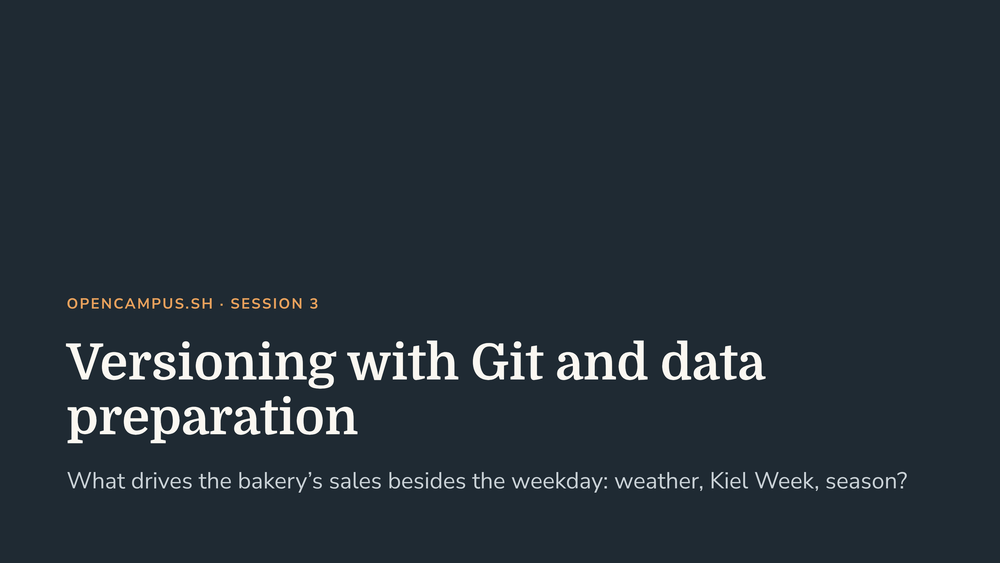

# Week 3 – Versioning with Git and Data Preparation (Part 1)

**Question of the week (from the operations manager):** _What drives the bakery’s sales besides the weekday: weather, Kiel Week, season?_

**Canvas focus:** blocks 2 and 5 (Questions, Data) · **Skills:** `/setup-ds-project`, `/grill-question`, `/explore-data`

This week you form your **project team of three or four**. In the session, one driver per team creates the team repository and the team grills the project question together; until the next session you explore the data as a team. Pushing and pulling as a whole team comes in week 4.

### This week you will ...

* distinguish statistical significance from practical relevance when making recommendations,
* explain local and remote repositories and use Git for versioning in VS Code,
* set up a team project: a repository with canvas, glossary and decision log, an Element team room and an EduHub project,
* merge several datasets and define checks that prove the merge is correct.

### In the session ...

#### 1. Form your team

* [x] **Introduce yourselves.** First, one minute each: your name, what you do, what you want to get out of the project, and when you can meet.
* [x] **Team number.** Online, your team number is the number of your breakout room. In the room, it is your table number with a leading 1 (table 3 → team 13). Add a short team name.
* [x] **Team room and GitHub usernames.** One person creates your team room in Element and invites the others. Everyone posts their GitHub username there. No GitHub account yet? Create one now (see [Preparation](preparation.md)).
* [x] **Team project on EduHub.** One person signs in on [EduHub](https://edu.opencampus.sh), opens the course page and clicks “Use this template” on the course’s project template there (not the GitHub template). The others request to join (see [Certificate and project submission](certificate.md#your-team-project-on-eduhub)).
* [x] **Choose the driver:** the person at the keyboard. The team works on the driver’s laptop with the driver’s agent, and everyone decides together; this week only the driver pushes. Choose someone whose agent works reliably (Claude Code or a paid plan are best).

#### 2. Try Git on your laptop

* [x] **Set your Git name and email** (once, everyone). Give the agent this prompt, with the email of your GitHub account:

  
  ```
  Set my Git user name to "<your name>" and my Git email to "<the email of my GitHub account>" for all repositories on this laptop, then show me both settings.
  ```
  
* [x] **Make one commit in your practice repository.** In VS Code’s _Source Control_ view (the branch icon in the side bar):
  1. change a line in a file,
  2. stage the change (the **+** next to the file),
  3. write a message and click _Commit_,
  4. look at the history.
* [x] **Try to send it to GitHub** with _Sync Changes_. Sign in to GitHub if VS Code asks. The push is refused, and that is the point. VS Code offers to create a fork: click **Cancel**.

<details>

<summary>Why is the push refused?</summary>

* A **commit** saves a version on your laptop. It always works.
* A **push** sends it to GitHub. It needs permission for that repository, and you do not have it for the course template.
* In your team repository, the driver adds you as a collaborator, so there you can push.

</details>

#### 3. Create the team repository (the driver)

* [x] **Create the repository from the template.** Open the [template repository](https://github.com/opencampus-sh/repo-template-intro-to-data-science-and-ml) and click **Use this template → Create a new repository**:
  * name it after your team,
  * choose **Public** (required for the [certificate](certificate.md)).
* [x] **Add the others** under _Settings → Collaborators_, with the usernames from the team room.
* [x] **Clone and open it.** In VS Code, use _Clone Git Repository…_, choose a folder next to the course resources folder and open the new folder.
* [x] **Only in Codex, Copilot or Cursor:** install the skills in this repository with the prompt from [week 1](week-01-introduction.md). The week 1 install only covered the practice repository.

<details>

<summary>Why “Use this template” and not a fork?</summary>

A fork stays linked to the course template. A repository made from the template is your team’s own, with its own history.

</details>

#### 4. Grill the project question together

* [x] **Set up the project.** The driver runs `/setup-ds-project` (in Codex: `$setup-ds-project`) and answers:
  * issue tracker: **local files**
  * checks: **accept the recommendation**
  * project name: **your team name**
  * team: **all members**
* [x] **Grill the project question.** The driver runs `/grill-question` with the project question right after the command:

  
  ```
  /grill-question Our client, the bakery’s operations manager, asks: how much of each product group should we bake for tomorrow?
  ```
  

  The driver types; the team decides each answer together, until blocks 1–4 and 6 of `CANVAS.md` are filled. Your week 1 practice repository is not carried over: use what you learned there, not its files.

<details>

<summary>How to answer the agent’s questions</summary>

* Start with the decision (block 1), not the data: who decides what, and when? The data only matters once that is clear.
* Each question comes with a recommended answer. Accept it when you have no reason against it; change it when you know something the agent does not, for example who decides, when the decision is made, or which error costs more.
* Facts the agent can look up itself (for example which period the data covers); decisions are yours (which question matters most, what counts as success).
* Disagree within the team first, then answer. The canvas records what you decided, so it should be what the team thinks, not what one person typed.

</details>

#### 5. Push the start (the driver)

* [x] **Fill in the team.** Write everyone’s name and role (for example data, charts, writing, or _tbd_) into the _Team_ section of `AGENTS.md`.
* [x] **Commit and push.** In _Source Control_, commit everything and click _Sync Changes_. The first time, VS Code asks the driver to sign in to GitHub.

No time left in the session? The driver does this step in the team call, once the grilling is done (see below).

**Slides:**

<figure><figcaption><p><a href="../../.gitbook/assets/intro-ds-week-03-slides.pdf">Open the session 3 slides (PDF)</a></p></figcaption></figure>

### Until next session you should ...

#### 1. Meet as a team: finish the grilling and explore the data

* [x] **Watch the merge video first** (≈ 11 minutes). It shows the join types you need for the data.

| Lesson / material | Source | Min |
| --- | --- | --- |
| [Pandas merge function](https://www.youtube.com/watch?v=HV1JadkJqkU): join types, `indicator`, merging on several keys | YouTube (datagy) | 11 |

* [x] **Meet in one team call**, with the driver at the keyboard. Only the driver needs the repository for this; the others join the call.
* [x] **Finish the grilling** until blocks 1–4 and 6 of `CANVAS.md` are filled.
* [x] **Push the start.** The driver fills in the _Team_ section of `AGENTS.md`, commits and pushes, as in step 5 above.
* [x] **Write down three guesses** about the data in the team room, before you read any output.
* [x] **Run `/explore-data`** and compare its results with your guesses. Lesson 3 of [Learn it in seven lessons](https://github.com/steffen74/agentic-data-science/blob/main/docs/lessons.md) explains `/explore-data` step by step.
* [x] **Check the merge before you accept it.** For the project, use a left join (`how="left"`), so that every sales day stays. With the tools from the video, check:
  * How many rows are there before and after the merge?
  * Are there rows without a match?
* [x] **Decide as a team.** Record every open data decision in `DECISIONS.md` and confirm the proposed checks.
* [x] **Choose three hypotheses** about what drives sales (for example weather, Kiel Week, season) and add them to block 2 of `CANVAS.md`. A hypothesis is a guess about one factor that the data can confirm or refute, for example “On rainy days, the bakery sells fewer rolls.”
* [x] **Share it.** At the end of the call, the driver commits and pushes again.

<details>

<summary>Missing values after the join</summary>

* Days without Kiel Week get 0 (see the [data README](https://github.com/opencampus-sh/intro-to-data-science-and-ml/blob/main/data/bakery/README.md)).
* Days without weather data stay missing.

</details>

#### 2. Join the team repository (everyone else)

* [x] **Accept the invitation** (by email or on GitHub).
* [x] **Clone the team repository** after the team call, in VS Code with _Clone Git Repository…_ into a folder next to the course resources folder, and open it.
* [x] **Get the team’s work** with _Sync Changes_ (pull). This week only the driver pushes. A pull cannot conflict as long as you have not changed the same files.

<details>

<summary>The Python environment (<code>.venv</code>)</summary>

Your agent sets up the Python environment (`.venv`) the first time it runs code. In notebooks, select `.venv` as kernel. Missing? Ask your agent to run `uv sync`.

</details>

#### 3. Analyse one hypothesis each

* [x] **One hypothesis per person.** In a team of four, two share one. Analyse it with descriptive statistics and visualizations in your own notebook:

  
  ```
  1_DatasetCharacteristics/<your name>-<hypothesis>.ipynb
  ```
  

  For example `1_DatasetCharacteristics/anna-rain.ipynb`.
* [x] **Commit it on your laptop.** Pushing it is the first exercise of session 4.


**Deliverable for the operations manager:** a one-page data fact sheet, one per team, in `docs/fact-sheet-for-manager.md` of your team repository; bring it to session 4: which data you use, which period it covers, what is missing, and the first answers to your three hypotheses. Base it on block 5 of your canvas and the fact sheet from `/explore-data`.


#### 4. Finish the team setup on EduHub

* [x] **Complete your team project on EduHub** so that the instructor can confirm your team (see [Certificate and project submission](certificate.md#your-team-project-on-eduhub)).

#### 5. Watch the other videos

* [x] **Watch these videos** (≈ 54 minutes).

| Lesson / material | Source | Min |
| --- | --- | --- |
| [Git in VS Code](https://www.youtube.com/watch?v=7fIP5aM6hyc) (in German; Git on your laptop: commits, branches, conflicts; the GitHub part comes in the session) | YouTube | 33 |
| [Creating the team repository](https://vimeo.com/944374865) (for the driver) | Vimeo | 3 |
| [Creating a Codespace from the team repository](https://vimeo.com/944377598) (only if you use Codespaces) | Vimeo | 2 |
| [Introduction](https://learn.deeplearning.ai/courses/spec-driven-development-with-coding-agents/lesson/8bhg0p/introduction) | Spec-Driven Development course | 4 |
| [Why spec-driven development?](https://learn.deeplearning.ai/courses/spec-driven-development-with-coding-agents/lesson/9i8xmt/why-spec%E2%88%92driven-development%3F) | Spec-Driven Development course | 4 |
| [Workflow overview](https://learn.deeplearning.ai/courses/spec-driven-development-with-coding-agents/lesson/vtd82x/workflow-overview) | Spec-Driven Development course | 3 |
| [Creating the constitution](https://learn.deeplearning.ai/courses/spec-driven-development-with-coding-agents/lesson/0kj4sq/creating-the-constitution) | Spec-Driven Development course | 5 |
| **Total** | | **54** |

<details>

<summary>The Spec-Driven Development videos and this course</summary>

The videos build a web app with the same idea you use: decide and write down before the agent builds, let the agent ask while you decide, review, then commit. Skip the course’s own setup (Node.js, WebStorm); you apply the ideas in your team repository. Their terms map to ours:

| In the videos | In this course |
| --- | --- |
| Constitution: mission, tech stack, roadmap | `CANVAS.md` (blocks 1–4) and the section `/setup-ds-project` writes into `AGENTS.md` |
| The agent’s interview with options | `/grill-question` |
| Feature spec: plan, requirements, validation | `/to-analysis-plan` with checkpoints and checks (week 4) |
| `specs/` folder | `CANVAS.md`, `DECISIONS.md`, `checks/` |

Do not create the videos’ files in your team repository; the canvas plays their role. And one difference: a software spec says what to build. Your canvas says what the operations manager decides and what you need to trust in the result, because the result itself cannot be specified in advance.

</details>

<details>

<summary>One agent, several windows</summary>

Claude Code is the same agent in the terminal (as in the videos), in the VS Code panel (as in this handbook) and in the desktop app. In the panel and in the app, it can run on your laptop or in the cloud; a cloud session starts from your team repository on GitHub, and its work comes back to your laptop through Git (pull). This handbook uses the VS Code panel on your laptop.

</details>

#### Optional

* [Joining Data with pandas](https://campus.datacamp.com/courses/joining-data-with-pandas/), chapter 1 (DataCamp, interactive, 60 min, free account): practise merges by typing them yourself.
* **P-values and confidence intervals, explained once more** (≈ 24 min), from the course *Applied Statistics for Data Analytics*, which the week 1 videos refer back to. Recommended if the quiz questions on p-values and confidence intervals were unclear to you:
  * [Confidence intervals](https://learn.deeplearning.ai/specializations/data-analytics/lesson/hmffw/confidence-intervals) (video, 5 min)
  * [Calculating the p value](https://learn.deeplearning.ai/specializations/data-analytics/lesson/wy6vl/calculating-the-p-value) (video, 4 min)
  * [Explaining Statistical Inference](https://learn.deeplearning.ai/specializations/data-analytics/lesson/hyicc/explaining-statistical-inference) (reading, 15 min)
* [Exploring GitHub integration and hooks](https://learn.deeplearning.ai/courses/claude-code-a-highly-agentic-coding-assistant/lesson/nngi6/exploring-github-integration-%26-hooks) (Claude Code course, 10 min): Claude reviewing pull requests on GitHub, and hooks. Watch only: do not install the GitHub app or hooks in your team repository.
* [Regular expressions](https://youtu.be/DRR9fOXkfRE) (11 min).
* The simulation videos of Python for Data Analytics, Module 4 (uniform and normal, ≈ 8 min).

**Estimated workload:** about 8.4 hours (session 1.75 h, videos 1.6 h including time to pause and rewind, tasks 5 h)
